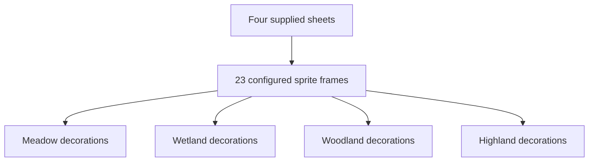
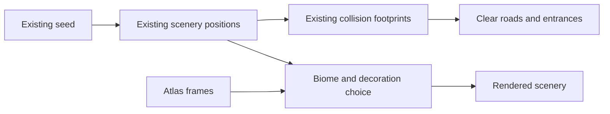

# Supplied biome decorations

## Implemented

All four new sheets in `Pictures/Game Assets` are integrated. The game frames 23 selected objects from transparent versions of `asset1.png` through `asset4.png`. Original source files are preserved.

| Biome | Added decoration |
|---|---|
| Meadow | Loom, craft stall, cloth rack, thatched gate, flowers, planters, fruit trees and woven baskets |
| Wetland | Waterwheel, bamboo bridge, well, bench, banana plants, palms and grass |
| Woodland | Bamboo, banyan trees, mossy rocks, logs, bench and signpost |
| Highland | Stone steps, campfire, well, logs, mossy rocks and grass |

Supplied objects replace selected existing scenery images. Existing placement, roads, collision footprints, seeds, station positions and save contracts remain unchanged. Half of the plant slots retain the original biome art, and existing animals remain. Bridges and steps are decorative scenery.

## Structure

## Relationship with navigation

## Changed files

- `public/assets/sprites/supplied-biome-1.png` through `supplied-biome-4.png`: transparent sheets, copied into the project.
- `src/content/biome-decorations.json`: atlas paths, 23 frame rectangles, display bounds and biome pools.
- `src/game/core/BiomeDecorations.ts`: stable decoration selection; animals keep their original art.
- `src/game/scenes/PreloadScene.ts`: local loading and scale-aware texture framing.
- `src/game/scenes/HubScene.ts`: aspect-preserving decoration rendering and development-only counts via the existing snapshot.
- `src/content/assets-manifest.json`: draft attribution for all four supplied sheets.
- Unit/browser/production tests: frame validity, pool references, all four sheets used in the hub and loaded offline.
- Art/status/session docs: current assets and verification.

## Verification

- `npm run typecheck`: PASS.
- `npm test`: PASS; 39 tests in 12 files. New checks validate frame bounds, unique IDs, atlas and biome references, and deterministic selection. Existing ten-seed road reachability checks still pass.
- `npm run build`: PASS; final static demo output includes the four local sheets.
- Browser: 6 focused tests PASS. All four roads were walked; seed/reload behavior, readable station labels, instructor interaction, M01 drag puzzle and exact hub return passed.
- After correcting frame edges, two focused browser checks PASS for all four sheets and the woodland route.
- `npm run test:production`: 3 PASS, 49.3 seconds. All three activities work with external assets blocked. All four supplied PNGs are explicitly checked for successful local loading. The local-loading case is repeated on the final trimmed-frame build.
- Visual inspection: all 23 frame previews and all four in-game biome views inspected. Frame edges were tightened to exclude neighboring objects. Contact sheet: `output/playtest/supplied-decoration-frames.png`.

## Image preparation and permission status

The built-in ImageGen tool prepared each transparent sheet using the same prompt:

> Edit target: the supplied pixel-art game asset sheet. Remove ONLY the plain white background, including white gaps inside open structures and between objects. Keep every object, original colors, shapes, pixel details, exact relative layout and proportions unchanged. Do not add, redraw, rearrange, crop, label, or combine any objects. Preserve the full sheet in its existing landscape aspect ratio. Output a truly transparent RGBA sprite atlas, ready to frame in the game. Keep the white/pale highlights on objects opaque; remove only background. No new shadow or text.

The manifest marks the four sheets `draft`, for local demo use pending publication permission and cultural representation review. No community identification or new learning fact is assigned to these objects. The project's original SVG license does not cover these supplied PNGs.

## Remaining blockers

No new functional blocker found. The full browser regression suite was not repeated for this decoration-only change. Physical laptop/projector checks and existing content/art permission review remain pending.

## Next prioritized task

Review the decorated roads on the intended presentation display and confirm art permission before public use.
