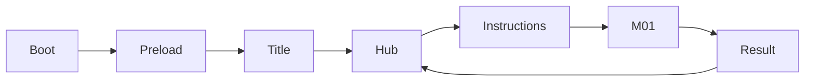
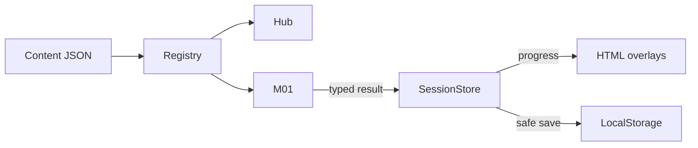

# Phase 0 design and decision tree

The user's explicit Phase 0–1 request confirms the design in [gameplan.md](gameplan.md). This session does not start M02.

| Decision | Evidence / answer | Dependency |
|---|---|---|
| What is built now? | One complete title/hub/M01/return path, AGENTS §14 | Scope |
| Which engine? | Pinned Phaser 4.2.1, strict TypeScript, Vite, AGENTS §2 | Runtime |
| Who owns progress? | Pure SessionStore, not a scene, AGENTS §7 | Results and saves |
| Is content culturally specific? | No: clearly labeled fictional paper cards, AGENTS §6 | Content gate |
| Which public test boundaries? | Content validation, session results/save recovery, puzzle placement; browser player controls | Acceptance checks |
| How are assets obtained? | Original locally generated pixel textures; no copied or remote assets | Offline startup |
| How is failure handled? | Explain errors, retry, skip, abandon to hub | No soft locks |

## Story beats
Nhật arrives → guide explains the fictional exhibition → Pattern Studio teaches the invented plan/cut/assemble sequence → passport records participation → hub invites a later return.

## Stations
| ID | Objective | Mechanic | Phase 1 |
|---|---|---|---|
| M01 | Order a clearly fictional paper-model process | Drag three steps into numbered slots; keyboard select/place alternative | Playable |
| M02 | Notice characteristics of approved audio | Visual/captioned rhythm input, slower and untimed modes | Disabled |
| M03 | Ask evidence-based questions about a reviewed story | Branching dialogue and information choices | Disabled |
| M04 | Connect approved clues | Route finding and inspection | Disabled |

## Contracts
See `src/game/core/types.ts`. Registry supplies station metadata and portal positions. Each activity receives `{minigameId, mode, seed?, returnPosition}` and emits one typed result. The result boundary updates the store before hub transition. Completed stamps and learned facts are sets. Abandon does not award a stamp; skip stays skipped.

