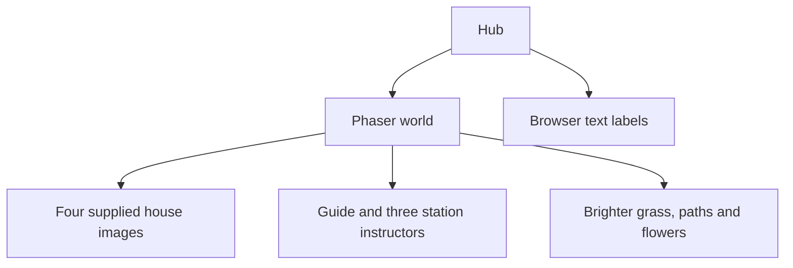
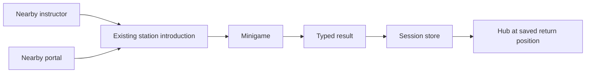

# Hub assets and readable labels

Updated 2026-10-26. The user requested supplied art for instructors and houses, a brighter map, and clear house labels.

## Implemented

- Two supplied character designs appear as the central guide and instructors beside the three active houses. Instructors open the existing station introduction. Their foot collisions use HubLayout, the same source used for save recovery.
- Four houses use the supplied wooden-house cutout. Small flower beds decorate both sides. Existing roads, portal coordinates, minigame state, and progress schema remain unchanged.
- Lighter local SVG grass and path colors brighten the map. The media generator contains the same palette, so regeneration preserves the change.
- House name/status labels use browser text above the roofs, with local Be Vietnam Pro, weight 800 names, and dark ink on cream. Names are 20 CSS pixels at 1280×720 and 30 at 1920×1080. Labels follow the camera and do not intercept input. Scene shutdown removes the nodes and render listener.

## Structure

## Interaction relationships

## Asset preparation and credits

The built-in ImageGen tool removed white backgrounds from the supplied `Gemini_Generated_Image_witzcqwitzcqwitz (2).png`, `(3).png`, and `(4).png`. The house filename was removed. Original files in Pictures/Game Assets were preserved. The composite contact sheets were not used as sprites because they contain printed labels and a baked checkerboard.

Project outputs:

- `public/assets/sprites/instructor-a.png`
- `public/assets/sprites/instructor-b.png`
- `public/assets/sprites/demo-house.png`

Preload defines trimmed texture frames within the PNGs. Display sizes preserve the visible figure proportions. Browser inspection confirmed transparent corners. The manifest marks this group `draft`; Sources and Credits exposes that metadata. Release validation rejects these assets until review. No new cultural identification or learning claim was added.

The three image-edit prompts used this shared text, with the substitutions below:

> Edit target: the supplied game asset image. Remove the solid white background completely; retain the original [subject] exactly, with identical silhouette, colors, proportions and pixel-art detail. [detail] Tight composition centered in a transparent canvas with small uniform transparent margin. No added text, shadows or decorations. This is a game sprite cutout, not a redesign. Save the output for project use.

- Instructor A and B subject: `full-body pixel character`; detail: `Keep the entire figure including headwear and shoes.`
- House subject: `wooden stilt house`; detail: `Remove the filename text below the house, leaving only the house.`

## Verification

- `npm run typecheck`: PASS, including the final build.
- `npm test`: PASS, 35 tests in 10 files. Added instructor collision/approach checks. Content tests isolate approved fixtures while actual imported art stays draft.
- `npm run build`: PASS, static demo output. The restricted Windows build-tool attempt failed on directory access; the same checks passed with the required process access.
- `npm run test:production`: PASS, 3 offline checks in 21.3 seconds, exit code 0. All three new PNGs loaded locally; no external asset requests. M01, M02 and M03 completed in production. The first restricted runner showed three passing cases but hung during server teardown and was stopped; the final run closed cleanly with normal process access.
- Targeted Playwright run: PASS, 9 tests across game, hub-art, hub-layout, and typography. The new label test first failed before implementation because browser labels did not exist.
- Browser paths: title → guide → M01 drag puzzle → exact hub return → replay → reload; keyboard movement, collisions, pause, skip, malformed saves, missing map, M04 unavailable state, and label/HUD geometry.
- New route: title → walk to M01 → walk to instructor → station intro → drag all three steps → stamp → exact instructor-side return. Four labels remain after return, without duplicates.
- Screenshots inspected at 1280×720 and 1920×1080. Layout tests also cover 2560×1440.
- `npm run build:release`: expected rejection for the three existing fictional facts and the new draft art group.

Screenshots: `output/playtest/hub-art-vi-1280.png` and `hub-art-vi-1920.png`.

## Changed files

- `src/game/scenes/HubScene.ts`: supplied house/instructor images, instructor interactions, camera-aligned browser plaques and cleanup.
- `src/game/scenes/PreloadScene.ts`: three local PNG loads and transparent-margin texture frames.
- `src/game/core/HubLayout.ts`: instructor foot collisions shared with saved-position recovery.
- `src/styles/main.css`: bold browser plaques and container-relative text sizing.
- `scripts/generate-media.mjs`, `public/assets/tiles/grass.svg`, `path.svg`: brighter reproducible terrain palette.
- `public/assets/sprites/instructor-a.png`, `instructor-b.png`, `demo-house.png`: supplied art prepared as transparent cutouts.
- `src/content/dialogues.json`, `assets-manifest.json`: localized instructor label and honest draft attribution.
- `tests/e2e/hub-art.spec.ts`, `typography.spec.ts`, `tests/production/offline.spec.ts`, `tests/unit/hub-layout.test.ts`, `content.test.ts`: interaction, text, offline media, collision and permission checks.
- `docs/ART_GUIDE.md`, `IMPLEMENTATION_STATUS.md`, `STATE.md`, and this report: current artwork, verification and review limits.

## Limits

This is a local demo. Imported artwork permission and cultural review remain pending. Projector-distance readability and physical laptop performance need a rehearsal. The full development browser suite was not repeated for this bounded change; the affected paths were checked.

## Next prioritized task

Check the updated hub on the intended presentation laptop/projector, then obtain art permission and cultural review before public teaching.
