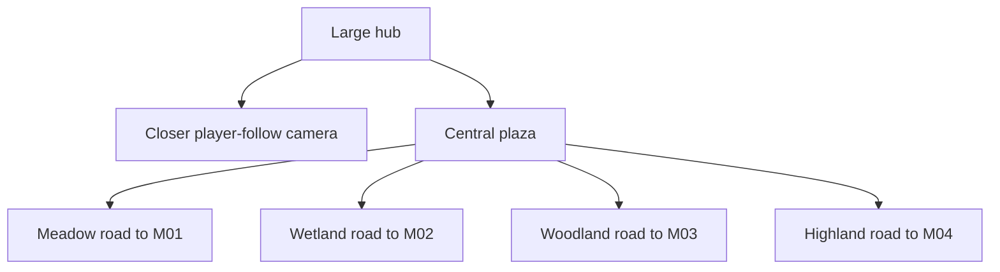
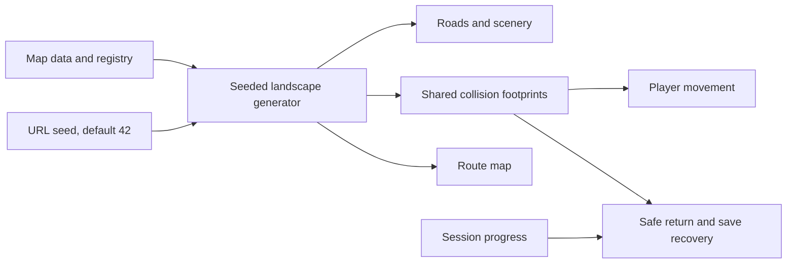

# Living trails verification

User request: zoom closer, enlarge the map, randomize topology, and give every station its own road with different flora, fauna and landscapes.

## Implemented

The world is now 2560×1920 pixels (80×60 tiles), compared with 1536×1152 before. Its area is approximately 2.78 times larger. Hub camera zoom increases from 0.8 to 1.25, so characters and scenery appear 56.25% larger. The logical screen remains 1280×720.

| Road | Station | Flora, fauna and landscape |
|---|---|---|
| Flower Meadow | M01 Pattern Studio | Warm grass, golden paths, wildflowers, butterflies, flower arches |
| Reed Wetlands | M02 Sound Garden | Moss ground, pale stone paths, reeds, herons, lily pools |
| Whispering Woods | M03 Story Trail | Green woodland, woodchip paths, broadleaf trees, songbirds, stumps and mushrooms |
| Stone Highlands | M04, available later | Sage ground, slate paths, angular rocks, rabbits, stone ridges |

These are fictional landscape themes. No cultural identity or real geography is assigned to a region.

The map is generated from a seed. Road bends, stepped ground patches, plants, animals and landmarks vary with that seed. The default is 42; `?mode=explore&lang=vi&seed=43` selects another layout. The same seed reconstructs the same world after minigame return or reload. Station endpoints remain fixed. This is constrained generation: it preserves access and does not generate elevation, bridges or mazes.

## Structure

## State and geometry relationships

## Changed files

- `src/game/core/HubLandscape.ts`: seeded roads, terrain and scenery; road/entrance reservation before placement.
- `src/game/core/HubLayout.ts`: shared generated obstacle support.
- `src/game/core/SessionStore.ts`, `types.ts`: larger position bounds and safe old-layout migration that preserves stamps.
- `src/game/core/MinigameRegistry.ts`: explicit JSON import attribute for shared Node/browser use.
- `src/game/scenes/HubScene.ts`: closer camera, biome rendering, decorative animal motion, route map and cleanup.
- `src/game/scenes/PreloadScene.ts`: load the 20 original local biome assets.
- `public/assets/maps/hub.json`, `src/content/minigames.json`: larger world and relocated station endpoints.
- `scripts/generate-biomes.mjs`, new `biome-*.svg` tiles/sprites: original themed artwork.
- `src/content/assets-manifest.json`, sprite license, dialogue/localization: attribution and current navigation directions.
- `src/styles/main.css`: route-map styling.
- Unit/browser tests and Playwright configs: seeded reachability, saves, geometry, walking routes and the longer exploration paths.
- README, design, technical, art, milestone and status docs: current map and verification.

## Verification

- Asset generator: PASS; 20 SVG files validated and read back. Main inspected the sprite sheet and the rendered scenery.
- `npm run typecheck`: PASS.
- `npm test`: PASS; 38 tests in 11 files. Road centerlines sampled every 8 pixels across ten seeds; all four station approaches stay clear. Deterministic regeneration, different seed output, biome variety, collision recovery and save migration pass.
- `npm run build`: PASS; static demo output.
- Focused browser run: PASS; 9 tests. Includes real keyboard walking from the plaza to all four stations, closer camera/map bounds, label readability at desktop resolutions, old save recovery and instructor → M01 drag puzzle → exact return.
- `npm run test:production`: PASS; 3 tests, 48.9 seconds. M01, M02 and M03 work with external assets blocked; all required art, fonts and audio load locally. Production still has no developer hooks.
- Full browser regression: PASS; 41 passed and 1 existing visibility skip among 42 tests, 4.4 minutes, exit code 0. Includes all three minigames, replay/reload, exact returns, skipped results, presenter travel, fullscreen, short/large windows, keyboard focus, storage failures, asset/font/audio faults and CPU-throttled input. The headless browser did not expose real tab hiding; the physical tab-switch case remains skipped. Synthetic blur/visibility guards pass.
- `npm run build:release`: expected rejection for the three existing fictional facts and supplied draft PNG art; the 20 original biome SVGs pass asset review validation.
- `git diff --check` on affected files: PASS.

The Windows browser/build tools needed normal process/file access; restricted attempts failed before running tests. Vite also emits a development warning about importing the public map JSON for shared save bounds; development and production launch, missing-map recovery, and offline checks pass. The map is embedded for synchronous save validation and also loaded as a critical local asset by Preload.

Main reviewed `output/playtest/living-trails-plaza.png`, `living-trails-M01.png`, `living-trails-M02.png`, `living-trails-M03.png`, `living-trails-M04.png`, and the 1280×720 / 1920×1080 label captures.

## Limits and next prioritized task

No physical projector/laptop rehearsal was run. The world uses top-down 2D terrain with constrained, seeded route bends and scenery. Existing learning content and supplied PNG art remain draft; public cultural teaching still requires review. M04 remains disabled. Next: test the longer walking route on the presentation hardware, then adjust the speaking plan if needed.
