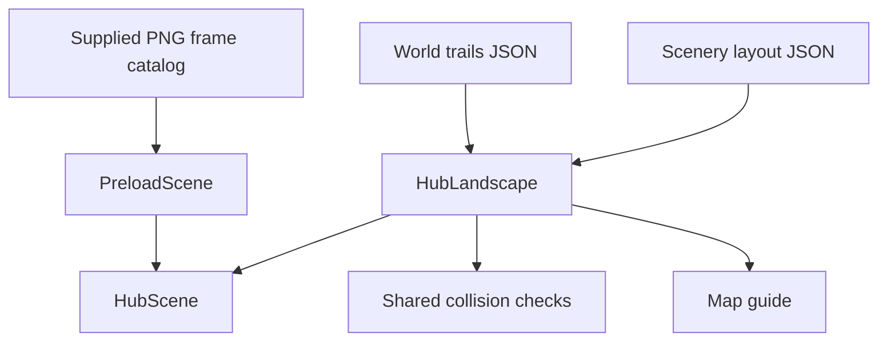
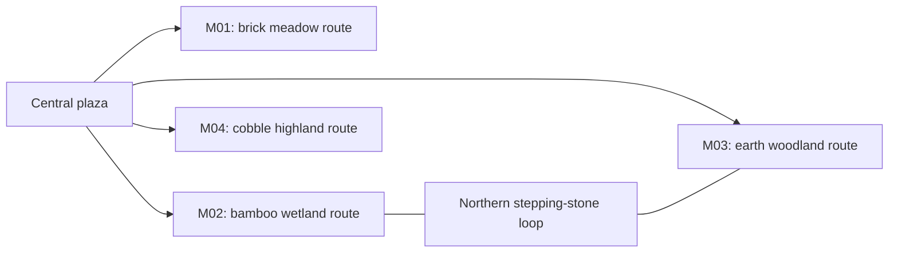

# Natural trails QA — 2026-10-26

## Implemented

The map has four winding station routes and a northern connecting loop. The new layout uses a forest boundary, grouped vegetation, an irregular lake and open activity areas. The reference image supplied these layout principles. Its objects and exact arrangement are not copied.

Selected matching sources: asset5.png supplies the roads; ảnh2.png supplies the steep wooden house and workshop objects; ảnh4.png supplies two front-facing clay houses. Other overlapping sheets were inspected but not imported. Three transparent copies are stored as nature-roads.png, nature-workshop.png and nature-houses.png. ImageGen removed white backgrounds. The original source files stay unchanged.

The meadow uses brick roads, the wetland bamboo, the woodland earth, and the highland cobble. The northern loop uses stepping stones. Wells remain beside houses. The loom is in the studio courtyard, the instrument near Sound Garden, and the anvil and hearth in highland activity areas. Existing instructor art and sharp HTML house labels remain.

## Structure

## Relationships

## Changed files

- src/content/world-trails.json: route points, road styles, house selection and grove centers.
- src/content/biome-decorations.json: new sheet frames and terrain samples.
- src/content/scenery-layout.json: new purposeful prop placement.
- public/assets/maps/hub.json: irregular lake mask.
- src/content/minigames.json: southern approaches align to the road grid.
- src/game/core/HubLandscape.ts: route rasterization, road joins, forest borders and seeded groves.
- src/game/core/HubLayout.ts: shared water-mask rectangles for rendering and collision.
- src/game/scenes/HubScene.ts, PreloadScene.ts: supplied roads, houses, lake and minimap rendering.
- Asset manifest, fact asset references and tests: local media provenance, route and offline checks.

## Verification

- Typecheck and development build: PASS. Release build rejects the three fictional facts and three draft supplied-art groups as expected. git diff --check: PASS.
- Unit tests: 41 PASS, including masked shoreline validation and route reachability across ten seeds.
- Focused browser tests: 7 PASS. Actual keyboard movement reaches each station and crosses the wetland bridge. House labels and minigame return work.
- Offline production: 3 PASS. External assets blocked; all three new PNG sheets load locally. M01, rhythm and story paths work.
- Full browser regression: 42 PASS / 1 existing physical-tab visibility SKIP (43 cases). Three minigames, exact returns, save recovery, presenter controls, resizing and readable labels pass.
- Visual inspection: new frame contact sheet, irregular lake view and full-map overview inspected. Water and grass samples corrected after inspection. Loom and anvil frames trimmed to remove neighboring objects.

Evidence: output/playtest/new-trails-overview.png, new-trails-lake.png, new-nature-frames.png. The overview uses a temporary camera setting in an isolated QA browser; normal player camera remains 1.25×. No camera/debug hook was added to production.

## Remaining blockers

Physical projector/laptop and real hidden-tab behavior remain unverified. Supplied media and fictional learning content remain draft. M04 remains disabled. Public cultural presentation is still gated by content and permission review.

## Next prioritized task

Rehearse on the intended presentation laptop and projector.

