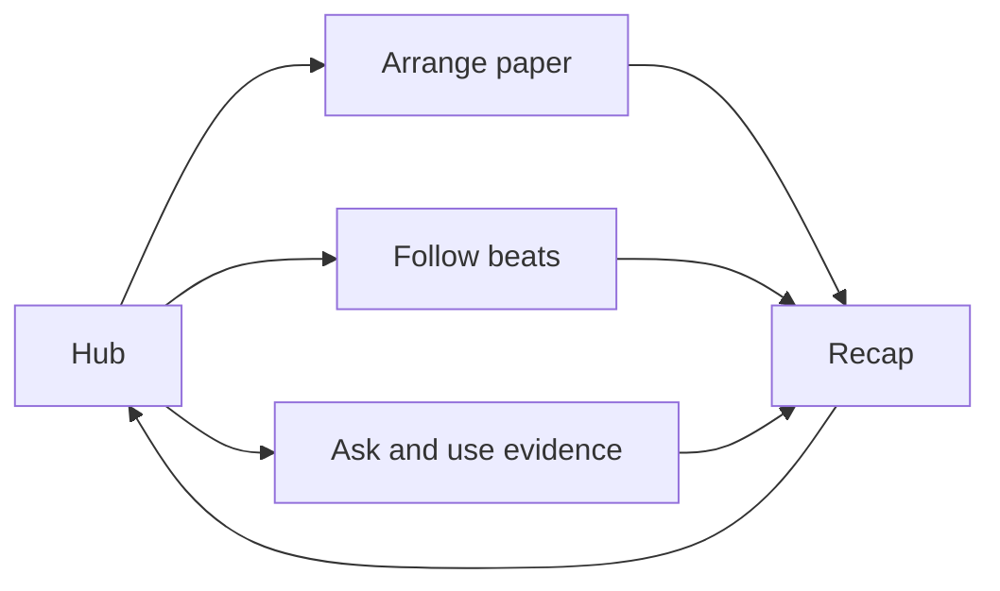
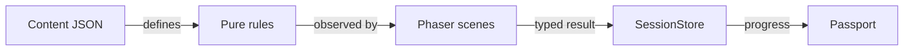

# Phase 2 implementation and QA report

Date: 2026-10-26. Scope: one local player in Microsoft Edge through Playwright. The game is a fictional demo; public cultural teaching readiness is not claimed.

## What this change does:
The hub now has three playable activities with different actions. M01 arranges paper-model steps. M02 follows an invented light rhythm. M03 asks fictional helpers, records their requests, and chooses a plan using that evidence.

## Implementation
- M02 pure `RhythmPractice` owns beat position, hit/rest rules, missed/extra inputs, retry and completion. Normal beats take 700ms; Slow takes 1100ms. Untimed requires explicit hit/rest actions and has no deadline.
- M02 scene advances timing only while active and unblocked. Pause/help/passport use the same block boundary. A restored frame is capped. There are no global intervals, audio loops, or scene-specific global input listeners.
- M03 pure `StoryPractice` owns unique evidence, attempts and plan eligibility. Three fictional individuals make personal requests. Assumptions have explanatory consequences and can be revisited. The notebook preserves actual recorded responses.
- Both scenes show instructions, mistake feedback, recovery, recap and a participation-stamp return. The existing typed result boundary updates the store before transition and preserves the actual entered portal position.
- Registry enables M01–M03; M04 remains disabled. The passport denominator reads the enabled registry count. Existing M01 progress remains compatible.
- An earlier skipped result survives entering and abandoning a later attempt. Repeated completion awards no duplicate stamp. Restart/back require confirmation and retain earned stamps.
- Bilingual content stays in JSON. All three facts remain `draft`, `fictional:true`, without cultural claims. The release gate remains closed.

The first diagram shows the activity flow. The second shows state and content ownership.

## Verification

| Command | Result |
|---|---|
| `npm run typecheck` | PASS; strict TypeScript, no diagnostics |
| `npm test` | PASS; 14 tests in 5 files |
| `npm run build` | PASS; 3 selected fictional facts; static local bundle |
| `npm run test:e2e` | PASS; 7 browser tests |
| `npm run test:production` | PASS; 2 cold production browser tests |
| `npm run build:release` | Expected rejection for demo-paper, demo-rhythm and demo-stories |
| `git diff --check` | PASS after mechanical whitespace cleanup |

Dependencies were reused. Phaser remains exactly 4.2.1; package scripts, save schema and dependency versions were not changed in Phase 2. No fresh installation was required or claimed.

## Exact browser paths
1. Retained Phase 1 route: title → hub → An → M01 instructions → wrong drag → correct drag → recap → exact-position return → keyboard replay → one stamp → reload/continue.
2. Retained collision/camera/pause/restart/skip/ending and missing-map/malformed-save recovery checks.
3. M02: walk left/north from plaza → instructions → Untimed → incorrect tap on rest → finish failed round → retry → pause → complete correct hit/rest sequence → recap → same portal with M02 stamp.
4. M02: Slow → simulated hidden-tab event → pause stays open and beats do not advance during 6000ms of stepped time → restore visibility → resume/restart → Normal timed sequence → complete → resize to 1920×1080 → return → revisit/skip without duplicating stamp.
5. Full route: M01 complete → walk to M02 and complete untimed → walk to M03 → plan blocked for missing evidence → assumption records no evidence → help panel blocks background actions → keyboard question choices collect all three requests → uniform plan receives explanation → evidence-based plan completes → exact-position return → Passport 3/3 → reload retains all stamps.
6. M03: abandon a partial conversation → no stamp → skip → re-enter and abandon → still skipped → restart clears current notes → complete → repeat completion still one M03 stamp.
7. Cold Vietnamese production: M01 completion and M02/M03 completion in explore mode with all external asset requests blocked. No external request occurred. No development snapshot/time hooks were exposed; explore mode has no presenter skip button.

The hidden-tab check simulates `document.hidden` and its visibility event. It is not a claim of physical tab-switch testing on the user's presentation hardware.

## Screenshots reviewed
`output/playtest/phase2-m02-1280.png`, `phase2-m02-1920.png`, `phase2-m03-1280.png`, `phase2-m03-1920.png`, and `phase2-production-story-vi.png`. M01 and hub regression screenshots were also retained. Text, focus targets, activity controls, recap, and notebook were inspected. Generated evidence files are local and ignored by Git.

## Qwen delegation and review
Application implementation and corrections were assigned to **Qwen3-Coder 30B**. Codex supplied requirements, bilingual content and independent browser tests; reviewed the actual files; and independently ran the checks.

The first two Qwen Code wrapper jobs were cancelled after incorrect test/contracts and waiting behavior. The same verified local model was then called through Ollama with explicit file/patch allowlists. This was a tool fallback, not a model substitution. Direct calls used a 24,576-token context cap and bounded output. One measured M02 request used 7,806 input and 5,713 output tokens.

Raw Qwen drafts were not accepted as evidence. Review caught and corrected invalid lifecycle visibility, missing initialization, UI cleanup ordering, access to private fields, missing imports, unlocalized data, wrong skip/return behavior, a blocked completion callback, stale recap state, stale attribution between helpers, and a CSS override of the shared studio bounds. Invalid or mismatched patches were rejected or mechanically matched to their unique authorized source; application code remained Qwen-generated. Temporary request/response artifacts are in ignored `output/qwen/`.

Fixed comparison baseline: `d81a6c36e309e06a0f72c043e9058ad4c9b5619d`. A separate draft-test snapshot was made before correction. Final implementation remains in the working tree for review; nothing was pushed.

## Review result
Standards review: pinned engine, strict types, pure state rules, existing scene/result contracts, scoped CSS, external content, no new runtime dependencies or global game timers.

Spec review: three different mechanics; instructions/action/feedback/recap; retries and untimed alternative; unique stamps, distinct skips, exact return; no fake approved cultural material. No remaining blocking finding for the Phase 2 demo mechanics.

The lead performed this review. A formal independent two-agent code-review workflow was not run; no originating issue-tracker setup or user-supplied comparison revision exists.

The changed interfaces were also checked against the [Web Interface Guidelines](https://raw.githubusercontent.com/vercel-labs/web-interface-guidelines/main/command.md): native buttons, visible focus, live feedback, confirmation before losing attempt state, keyboard alternatives and bounded/scoped layouts. This is not a full WCAG certification.

Verdict: Ship the Phase 2 demo for user playtest.

## Not checked / remaining limits
No approved cultural lesson, authentic instrument recording, final artwork, full guided 5–7 minute route, M04 gameplay, touch movement, or actual projector/low-powered laptop test. Native fullscreen and physical hidden-tab behavior on that hardware remain user checks. M02 is deliberately a silent visual demo. These limits prevent claiming the full educational MVP is presentation-ready.
