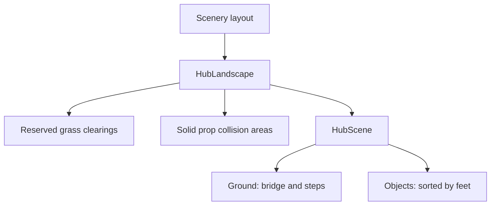

# Scenery ground and layer fix — 2026-10-26

## Implemented

The bridge and stone steps now draw on the walkable ground layer. Solid props, houses and characters use their foot position for depth order. The player draws in front of a prop when standing on its southern side; standing behind a tall object can still produce normal top-down overlap. Solid props now block 80% of their width and the lower 55% of their authored display bounds, instead of a narrow 60%-width strip capped at 36 pixels. This prevents walking into the visible lower part of the hearth and other large props.

Removed the separate orange dirt, gray stone, dark wood and brick rectangles under scenery. Clearings now reserve plant-free space on the same continuous grass surface. Supplied road tiles, the central plaza and props remain. No image was redrawn.

## Structure

## Draw relationships

## Changed files

- src/game/scenes/HubScene.ts: ground layer and consistent foot-based object/character depths; remove mismatched clearing textures.
- src/game/core/HubLandscape.ts: ground flag on walkable props, wider solid footprints and clearings as reserved rectangles.
- src/content/scenery-layout.json: remove unused clearing texture IDs and mark steps walkable.
- tests/e2e/scenery-layers.spec.ts: actual Phaser scene regression with a QA-only intercepted module; no production debug hook.

## Verification

- Reproduction failed before the fix: bridge depth 448, steps depth 1448, and five incompatible ground patches. The same regression passes after the fix.
- Typecheck/build: PASS.
- Unit tests: 41 PASS, including road/bridge reachability across ten seeds and saved-position checks.
- Focused browser: 8 PASS. All four roads, bridge crossing, instructor/M01 return, ground layers, hearth collision and coherent grass checked. Added explicit front-of-hearth depth assertion also PASS.
- Offline production: 3 PASS. Cold M01, Vietnamese rhythm/story and guided local-art/audio loading work with external assets blocked.
- Screenshot inspected: output/playtest/scenery-ground-layering.png. The exact highland work area now uses continuous grass; the character remains visible in front of the hearth/log area.

## Remaining blockers

Physical laptop/projector testing was not repeated. Full unrelated browser suite was not repeated for this bounded fix. Existing supplied-art permission and cultural-content review remain pending. M04 remains disabled.

## Next prioritized task

Check the corrected scenery on the intended presentation display.

