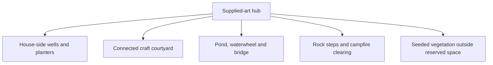
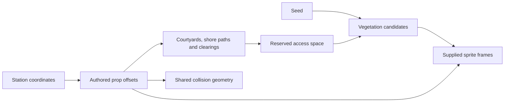

# Purposeful scenery redesign

## Implemented

The user's supplied artwork replaces every visible generated world sprite and terrain tile, including the player and title background. The original generated animals are removed because no replacement animal images were supplied. Fonts, game controls and electronic interface audio retain their roles.

| Area | Placement rule |
|---|---|
| Four houses | A well sits within 200 world pixels of each house; planters flank the entrance |
| Pattern Studio | Loom, cloth rack, baskets and stall share a brick courtyard connected to the station road |
| Wetland pond | Waterwheel sits on the bank; bridge spans the water and has a clear wooden approach; bench sits by the bank |
| Woodland house | Logs and a bench form a small house-side area; bamboo and trees stay outside access space |
| Highlands | Steps sit beside rocks; campfire and logs use a separate bare-ground clearing |

Functional props have fixed, data-authored positions. Only vegetation is randomly placed within the appropriate biome. Roads, pond access, work yards and clearings are reserved before plant placement. The same seed reconstructs the same layout on return.

The supplied player keeps the existing 22×18 world-pixel hitbox, including its 3–21 pixel vertical foot offset. A small walking sway respects Low motion. Scene result and progress contracts are unchanged.

## Structure

## Placement relationships

## Changed files

- `src/content/scenery-layout.json`: house/pond prop anchors, clearings and bridge approach.
- `src/content/biome-decorations.json`: 32 supplied frame definitions, including terrain and pond pieces.
- `src/game/core/HubLandscape.ts`: authored props and water/bridge collision geometry; reserved access areas before vegetation placement.
- `src/game/core/BiomeDecorations.ts`: validated frame lookup; removed the old mixed generated/supplied selector.
- `src/game/scenes/PreloadScene.ts`: supplied PNG loading and terrain sampling; generated SVG/animal loading removed.
- `src/game/scenes/HubScene.ts`, `TitleScene.ts`: supplied-only world/title rendering, pond assembly and supplied player with preserved collision dimensions.
- Asset manifest, learning-fact media references and bilingual credits: current supplied-media attribution; inactive generated asset groups removed from displayed credits.
- Unit/browser tests: meaningful placement constraints, multi-seed road/clearing protection, walkable bridge and no generated SVG image requests.
- Art/README/status/session docs: current design and verification.

## Verification

- New purpose-based placement test failed before implementation, then passed.
- `npm run typecheck`: PASS.
- `npm test`: PASS; 40 tests in 12 files. Wells, waterwheel and craft grouping checks pass. All four road centerlines remain clear across ten seeds. Plants stay out of authored clearings and shore access. Bridge corridor is walkable; pond water outside it blocks the player.
- `npm run build`: PASS; static demo.
- Browser walking/labels/instructor/M01 return: 6 focused checks passed during the redesign.
- Full first regression found one blocked bridge approach: a random palm occupied the unreserved path. The shared scenery layout now reserves and renders that wooden approach. The focused bridge crossing then passed in 17.2 seconds.
- Final full browser regression: PASS, 42 passed and 1 existing physical-visibility skip among 43 cases, 4.8 minutes, exit code 0. Includes real bridge crossing, all four roads, supplied player movement/collision, three minigames and exact returns, replay/reload, presenter controls, resize/fullscreen/focus and fault recovery. The supplied-art test records zero SVG world-image requests.
- Final offline production checks: PASS, all 3 cases, 49.1 seconds. All three activities work with external requests blocked and all required images load locally.
- `git diff --check` for affected files: PASS.
- `npm run build:release`: expected rejection for existing fictional facts and the two supplied draft media groups.

Main inspected the courtyard, house-side wells, pond/waterwheel and bridge views. `output/playtest/scenery-studio-courtyard.png` uses a valid saved-progress fixture for visual inspection; its 1/3 passport is test progress. `output/playtest/scenery-lakeside-bridge.png` records the real keyboard crossing.

## Remaining blockers

No physical projector/laptop rehearsal was run. Supplied artwork permissions and qualified cultural review remain required before public cultural teaching. Stone steps are scenery; no elevation/climbing system was added. Historical generated image files remain in the checkout, but the active game does not request them.

## Next prioritized task

Review the supplied-art layout on the presentation display, then complete media permission and cultural-content review.
